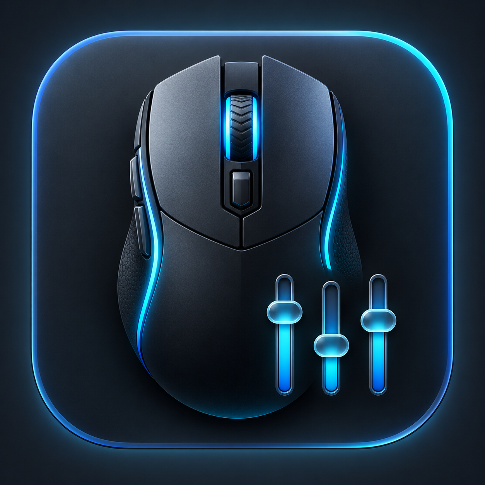

# Kone XP Configurator for macOS

<p align="center">
  
</p>

ROCCAT's configuration software is not available for macOS, which leaves Mac
users unable to remap the many buttons on the wired Kone XP or store changes in
its onboard profiles. **Kone XP Configurator solves that problem without a
Windows PC.** It reads the mouse's existing profile, changes one assignment,
writes it to onboard memory, and reads it back to verify the result.

Once saved, the assignment stays in the mouse and works on other computers and
operating systems without this app running.

## What it can do

- Configure all 15 physical controls, including the separate T1, T2, T3, and
  T4 thumb buttons and the Easy-Shift paddle.
- Edit both the Standard and Easy-Shift layer in any of the five onboard
  profiles.
- Assign mouse clicks, scrolling, browser navigation, DPI actions, media
  controls, profile cycling, Easy-Shift, and common keyboard keys.
- Activate the edited profile, commit it to onboard memory, and verify the
  saved button table by reading it back.
- Create a local backup of the mouse's feature reports before making changes.

## Compatibility

- **Mouse:** wired ROCCAT Kone XP, USB ID `1e7d:2c8b`
- **macOS:** 13 Ventura or newer
- **Mac:** Apple Silicon and Intel (the release is a universal binary)

This project was developed and tested with one wired Kone XP. The Kone XP Air
and other ROCCAT models use different USB interfaces and are not supported.
Firmware revisions can differ, so create a backup before editing and please
report your mouse firmware and macOS version when filing an issue.

## Install

1. Download `Kone XP Configurator.zip` from the latest GitHub release.
2. Unzip it and move **Kone XP Configurator** to Applications.
3. On first launch, Control-click the app and choose **Open**. The current
   community build is ad-hoc signed, but not Apple-notarized.
4. If macOS asks, enable **Kone XP Configurator** in **System Settings › Privacy
   & Security › Input Monitoring**, then quit and reopen the app.

The app does not require an account or Internet connection. It communicates
directly with the USB mouse.

## Use

1. Connect the wired Kone XP.
2. Open the app. It selects the currently active onboard profile automatically.
3. Choose a profile, Standard or Easy-Shift layer, physical button, and action.
4. Select **Create backup** before your first change.
5. Select **Save to mouse**. Success means the app wrote the assignment,
   activated the profile, committed it, and verified it by reading the mouse
   back.

Backups are stored in `Documents/Kone XP Backups`. They can contain your button
maps and macro-related device data; treat them as private and do not attach them
to public issues without reviewing their contents.

## Build from source

Xcode Command Line Tools are required.

```sh
make app
```

The universal app archive is created at
`outputs/Kone XP Configurator.zip`.

The command-line helper can also be built and used directly:

```sh
make
build/konexp backup kone-xp-backup.json
build/konexp buttons 5
build/konexp active-profile
build/konexp identify 10
build/konexp set-action 5 standard 10 volume-up
```

## Safety and project status

This is an independent, experimental community project and is not affiliated
with or endorsed by ROCCAT or Turtle Beach. It writes to onboard mouse memory.
The app limits a save to one assignment, recalculates the device checksum, and
verifies the result, but you use it at your own risk.

ROCCAT and Kone are trademarks of their respective owners.

## Privacy

The application contains no analytics, telemetry, network code, credentials,
or personal paths. Mouse configuration and backups stay on your Mac.

## License

MIT. See [LICENSE](LICENSE).
